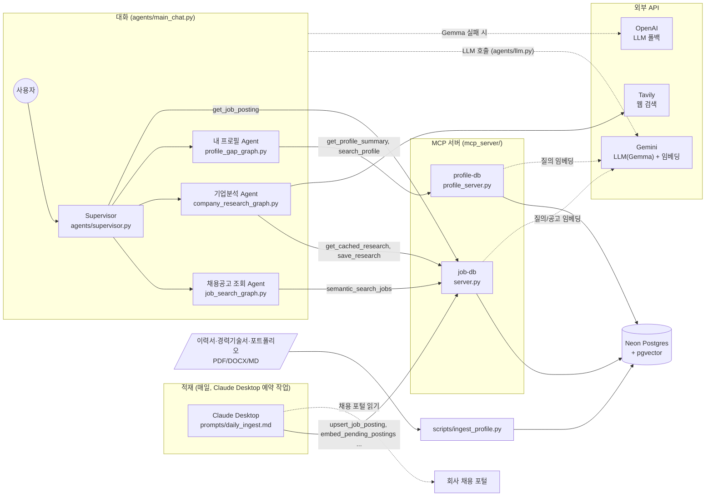
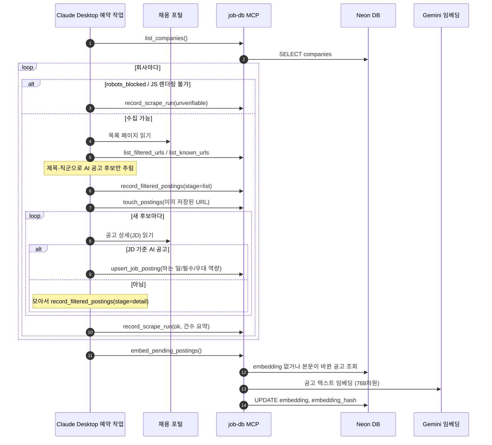
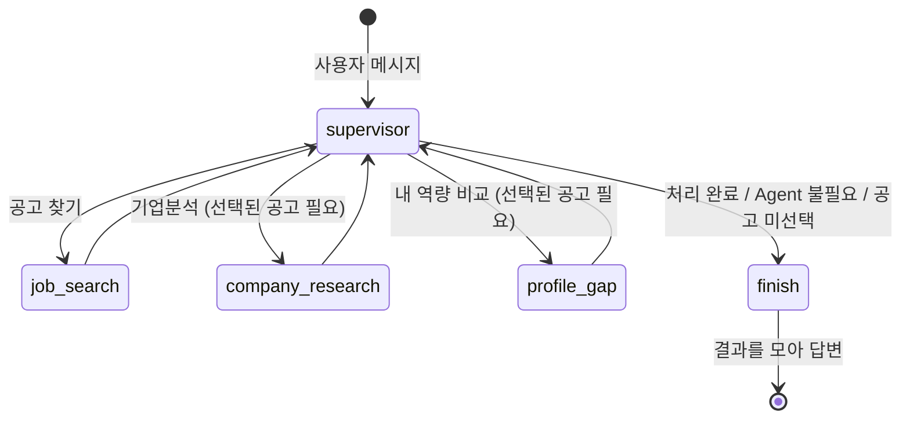
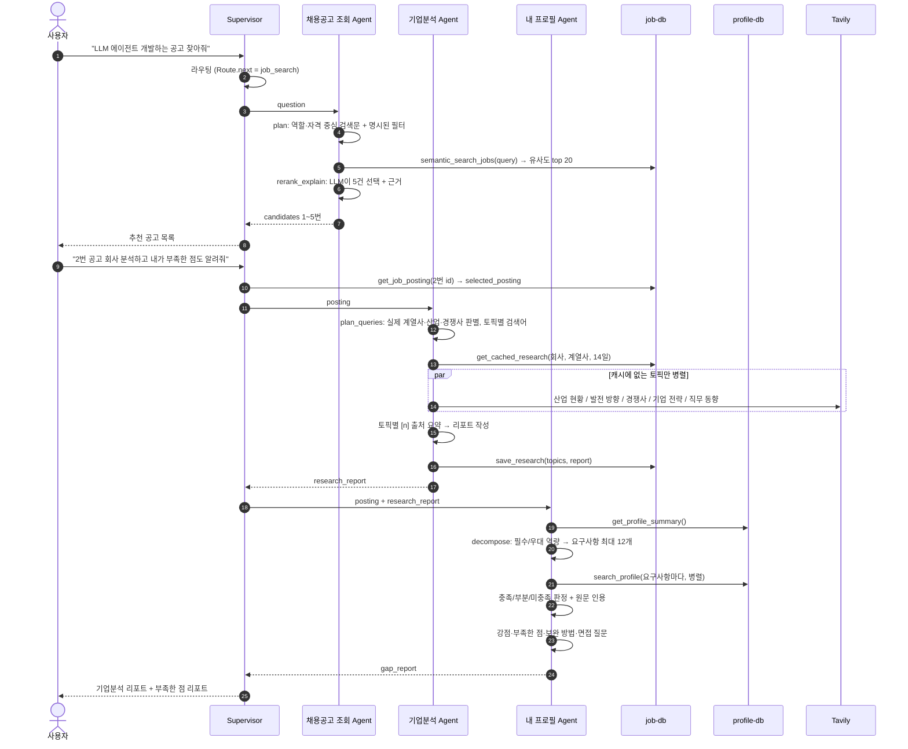
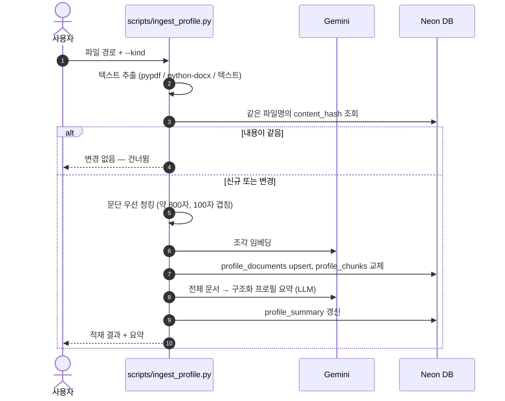

# recruit-posting-agent
이직준비를 위한 agent 구성

## 폴더 구조
```
make-agents/
├── agents/          # LangGraph 에이전트 (그래프·상태·LLM·MCP 연결)
├── mcp_server/      # DB 접근 계층: MCP 서버 2개 + 임베딩
├── db/              # Postgres 스키마
├── scripts/         # 1회성/관리용 CLI
├── scrapers/        # 수집 대상 회사 목록
├── prompts/         # Claude Desktop 예약 작업 프롬프트
├── tests/           # unit_tests(가짜 LLM·도구) / integration_tests(실제 DB·API)
└── README.md, PLAN.md, CHANGELOG.md, pyproject.toml, uv.lock, .env.example
```

### `agents/`: 에이전트
| 파일 | 역할 |
|---|---|
| `state.py` | 모든 그래프의 상태(TypedDict)와 LLM 구조화 출력 스키마(pydantic). 적재용 / Agent별 / Supervisor용 섹션으로 나뉨 |
| `llm.py` | LLM 공용 래퍼 `LLM`. 기본 Gemma → 시간 초과·에러 시 `gpt-6-luna` 폴백, 실패하면 5분간 Gemma를 건너뛰는 서킷 브레이커. `schema=`면 구조화 출력 |
| `mcp_client.py` | MCP 서버 2개 연결. `get_tools()`(호출마다 서버 기동, 단발 실행용) / `open_tools()`(세션 유지, REPL·테스트용) |
| `supervisor.py` | **Supervisor**. 라우터 LLM이 다음 Agent를 고르고, "2번 공고"를 추천 목록에서 찾아 선택. 한 턴 최대 3개 Agent, Agent별 MCP 도구 제한 |
| `job_search_graph.py` | **채용공고 조회 Agent**. `plan`(검색문·필터) → `retrieve`(`semantic_search_jobs` 상위 20건) → `rerank_explain`(LLM이 5건 선택·근거) |
| `company_research_graph.py` | **기업분석 Agent**. `plan_queries`(실제 계열사·산업·경쟁사, 토픽별 검색어) → `load_cache`(14일) → `search_topic`×N(Tavily 병렬) → `synthesize`(리포트·출처) |
| `profile_gap_graph.py` | **내 프로필 Agent**. `load` → `decompose`(요구사항 분해) → `match`(요구사항별 이력서 근거 검색·판정) → `synthesize`(강점/부족한 점/보완 방법) |
| `main_chat.py` | 대화 CLI (`/select N`, `/id ID`, `/reset`, `/quit`) |
| `query_graph.py` + `main_query.py` | 단발 질의 그래프. `search_jobs`(제목 키워드 + 하는 일/필수/우대 질의문별 임베딩 유사도)로 검색. 공용 `_parse()`(MCP 결과 정규화)도 여기 있음 |
| `ingest_graph.py` + `main_ingest.py` | Python으로 직접 돌리는 적재 그래프. 현재 주 경로는 Claude Desktop 예약 작업이고 이것은 API 방식 대안 |

### `mcp_server/`: DB 접근 계층
| 파일 | 역할 |
|---|---|
| `server.py` | **`job-db`** MCP 서버. 적재(`upsert_company`, `upsert_job_posting`, `list_known_urls`, `touch_postings`, `record_filtered_postings`, `list_filtered_urls`, `record_scrape_run`), 검색(`semantic_search_jobs`, `search_jobs`, `get_job_posting`, `list_companies`), 임베딩(`embed_pending_postings`), 리서치 캐시(`get_cached_research`, `save_research`). 커넥션 풀 `pool()` |
| `profile_server.py` | **`profile-db`** MCP 서버. 개인 자료 읽기 전용(`get_profile_summary`, `search_profile`, `list_profile_documents`). 예약 작업에는 등록하지 않아 이력서가 노출되지 않음 |
| `embeddings.py` | Gemini 임베딩(768차원) `embed_documents`/`embed_query`, 무료 티어 대응 배치·재시도, pgvector 변환, 해시 |

### `db/schema.sql`: 테이블
| 테이블 | 용도 | 사용 |
|---|---|---|
| `companies` | 수집 대상 회사, 포털 URL, 접근 방식, 산업 | 적재 |
| `job_postings` | 공고(하는 일/필수/우대 역량) + 통합·컬럼별 임베딩 | 적재 → 채용공고 조회 |
| `scrape_runs` | 회사별 수집 성공/실패 로그 | 적재 |
| `filtered_postings` | AI 공고가 아니라고 걸러낸 공고(필터 검수용) | 적재 |
| `profile_documents` / `profile_chunks` / `profile_summary` | 이력서 원문 / 검색용 조각+임베딩 / 구조화 요약 | 내 프로필 |
| `company_research` | 리서치 결과(회사+계열사 단위 캐시) | 기업분석 |

### 그 밖
| 경로 | 내용 |
|---|---|
| `scripts/seed_companies.py` | `scrapers/companies.py`의 회사들을 DB에 등록(최초 1회) |
| `scripts/embed_postings.py` | 임베딩이 없거나 바뀐 공고 백필 |
| `scripts/ingest_profile.py` | 이력서·경력기술서·포트폴리오(PDF/DOCX/MD/TXT) 적재 |
| `scrapers/companies.py` | 수집 대상 회사 메타데이터(URL, 접근 방식, 필터 조건) |
| `prompts/daily_ingest.md` | Claude Desktop 예약 작업 프롬프트와 MCP 등록 방법 |
| `tests/conftest.py` | 가짜 LLM(`fake_llm`)·가짜 MCP 도구(`make_tools`)·`--run-integration` 옵션 |
| `tests/unit_tests/` | Agent별 단위 테스트(네트워크 없음, 1초 내) |
| `tests/integration_tests/` | Agent별 실제 호출 테스트(Neon·Gemini·OpenAI·Tavily 사용) |
| `PLAN.md` / `CHANGELOG.md` | 단계별 계획·체크리스트 / 변경마다 무엇을·왜·검증 기록 |
| `openai_agents_tutorial.ipynb` | 이 프로젝트와 무관한 튜토리얼 노트북 |

## 테스트
```bash
uv run pytest                                            # 단위 테스트만 (가짜 LLM·도구, 네트워크 없음)
uv run pytest --run-integration tests/integration_tests -s   # 실제 DB·LLM·Tavily 호출 (약 2~3분, Tavily 쿼터 사용)
uv run pytest --run-integration -k job_search -s          # Agent 하나만: job_search / profile_gap / company_research / supervisor
```
- 프로필 자료가 없으면 `profile_gap` 통합 테스트는 건너뛴다.
- `company_research` 통합 테스트는 결과를 `company_research` 테이블에 저장한다(14일 캐시로 재사용).

## 전체 동작 흐름

### 1. 구성도
두 흐름이 같은 Neon DB를 공유한다. **적재**는 Claude Desktop 예약 작업이 하고, **대화**는 Supervisor가 3개 Agent를 조율한다.
Agent는 DB에 직접 SQL을 쓰지 않고, 정해진 MCP 도구만 호출한다.



### 2. 적재 흐름 (예약 작업)


### 3. 대화 한 턴의 흐름 (Supervisor)
한 턴에서 Supervisor는 Agent를 하나 실행할 때마다 다시 판단한다. 같은 Agent는 한 번만, 최대 3개까지 실행하고 `finish`에서 결과를 모아 답한다.



### 4. 대표 시나리오: 공고 찾기 → 기업분석 → 부족한 점


### 5. 프로필 적재 흐름


## 내 프로필 자료 넣기
```bash
mkdir -p data/profile   # gitignore됨. 원본 파일은 여기 둔다
uv run python scripts/ingest_profile.py data/profile/resume.pdf --kind resume
uv run python scripts/ingest_profile.py data/profile/career.docx --kind career
uv run python scripts/ingest_profile.py data/profile/portfolio.md --kind portfolio
```
- 지원 형식: `.pdf` `.docx` `.md` `.txt` (스캔 이미지 PDF는 텍스트가 없어 건너뜀)
- **개인정보 주의**: 추출한 텍스트는 Neon DB(`profile_*` 테이블)에 저장되고, 임베딩·요약을 위해 Gemini/OpenAI API로 전송된다.
  주민번호·연락처 등 불필요한 정보는 지우고 넣는 것을 권장한다.
- 개인 자료는 `profile-db` MCP 서버로만 조회된다(예약 작업용 `job-db`에는 노출되지 않음).

## Multi-Agent 대화 (채용공고 조회 · 기업분석 · 내 프로필)
```bash
uv run python agents/main_chat.py
> LLM 에이전트 개발하는 공고 찾아줘          # 채용공고 조회 Agent (임베딩 RAG)
> 2번 공고 회사 분석해줘                     # 기업분석 Agent (Tavily 웹 리서치, 출처 포함)
> 이 공고 기준으로 내가 부족한 점 알려줘      # 내 프로필 Agent (이력서 근거 gap 분석)
> 3번 공고 기업분석하고 내 부족한 점도        # 여러 Agent를 순서대로 실행
```
- 명령: `/select N`(추천 N번 선택), `/id ID`(공고 id로 선택), `/reset`, `/quit`
- 필요 키: `GOOGLE_API_KEY`(LLM·임베딩), `OPENAI_API_KEY`(폴백), `TAVILY_API_KEY`(기업분석), `NEON_DATABASE_URL`
- 공고 검색 점수: 하는 일 / 필수 / 우대 역량을 **컬럼별 벡터**로 비교해 `0.5 / 0.35 / 0.15` 가중합한다(값이 없는 컬럼은 빼고 정규화).
  `semantic_search_jobs(w_responsibilities=, w_required=, w_preferred=)`로 가중치를 바꿀 수 있고, 결과에 `sim_*` 컬럼별 유사도가 포함된다.
- 새로 적재된 공고는 `embed_pending_postings`(예약 작업 마지막 단계) 또는 `uv run python scripts/embed_postings.py`로 임베딩해야 검색된다.
