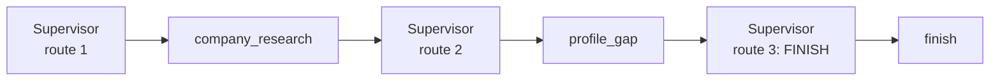
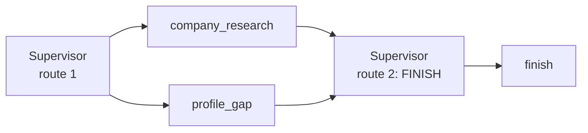

# Supervisor 병렬 실행(Fan-Out) 전환

- 변경일: 2026-11-16 (커밋 `6b754c5`, CHANGELOG #53)
- 대상: `backend/agents/graphs/supervisor.py`, `backend/agents/state.py`

## 요약

공고가 정해진 뒤의 **기업분석(`company_research`)과 내 프로필 분석(`profile_gap`)을 한 단계에서 동시에 실행**하도록 바꿨다.
- Supervisor의 route 호출이 3회에서 2회로 감소
- 같은 요청(기업분석 + 역량 분석)의 응답 시간이 **38.3초에서 20.2초로 줄었다**(실측 1건씩, 아래 [효과](#효과-실측) 참고).

## 기존 구조

사용자의 쿼리에 따라 Supervisor가 Agent 하나를 골라 실행하고, 결과를 받으면 다시 Supervisor로 돌아와 다음 Agent를 route했다.
기업분석과 역량 분석을 동시에 실행할 수 없었다.

### 그렇게 했던 근거

채용공고를 찾고 → 그 공고로 기업분석을 하고 → 역량 분석을 하는 흐름을 **차례대로 진행하는 작업**으로 생각해서 순차 구성으로 만들었다.

## 문제

기업분석과 역량 분석은 **채용공고가 선택되면 서로 독립적으로 실행할 수 있다.** 그런데 순차 구조라서 두 가지 비용이 생겼다.

1. **지연 시간**: 기업분석이 끝나야 역량 분석이 시작된다. 두 분석의 시간이 그대로 더해진다.
2. **Supervisor 재호출**: 둘을 동시에 요청해도 Agent 하나가 끝날 때마다 Supervisor로 돌아와 route(LLM 호출)를 다시 해야 한다. 라우팅 LLM 호출과 그 토큰이 한 번 더 든다.

## 변경

**Fan-Out 방식**으로 바꿨다. Supervisor가 한 번의 route에서 실행할 Agent를 여럿 고르면 LangGraph가 같은 단계(superstep)에서 모두 실행한다.

### 구현 요약

| 항목 | 내용 |
|---|---|
| 라우팅 | `Route.parallel_with`에 함께 실행할 Agent를 담는다. `route_next`가 노드 이름 리스트를 반환하면 LangGraph가 병렬 실행한다 |
| 정리 규칙 | `normalize_route_agents`: 이번 턴에 이미 실행한 Agent는 제외한다. `job_search`는 분석할 공고를 정하는 단계라 항상 단독으로 실행한다 |
| 상태 병합 | `steps`, `turn_outputs`에 reducer를 붙였다. 노드는 자기 몫의 증분(`1`, `[{agent, text}]`)만 반환하고 합치는 일은 reducer가 한다 |
| 턴 초기화 | `input_to_agent_state`가 `steps`, `turn_outputs`에 `None`을 넣으면 reducer가 초기화한다 |
| 진행 표시 | "기업분석 · 내 프로필 단계로 진행 (동시 실행)"으로 SSE 이벤트를 보낸다 |

병렬 노드가 같은 키에 쓰면 LangGraph는 reducer 없이는 `InvalidUpdateError`를 낸다. 기존 `_output()`은 `state["turn_outputs"] + [새 항목]`으로 읽고 덮어썼는데, 병렬에서는 둘 다 같은 옛 값을 읽어서 **한쪽 결과가 에러 없이 사라진다.** 그래서 reducer가 필수였다.

### 방식 선택: Agents as tools를 쓰지 않은 이유

Agents as tools(Supervisor LLM이 하위 Agent를 도구로 호출)도 검토했지만 Fan-Out을 골랐다.

- 병렬로 실행하는 Agent가 **고정**되어 있다(공고 확정 후 기업분석 + 역량 분석). 하위 Agent 수와 호출 조합이 많지 않아 LLM이 호출 순서를 정하게 할 이점이 작다.
- 도구 방식은 하위 Agent의 긴 결과(리포트)가 Supervisor LLM 컨텍스트를 거쳐 다시 나와야 해서 토큰과 지연이 늘어난다.
- 상태(`candidates`, `selected_posting`, `research_report`, `gap_reports`)를 갱신하려면 `Command`/`InjectedState`가 필요해 구현이 복잡해진다.
- `Send`도 필요 없었다. 두 노드는 공유 `AppState`를 읽고 각각 한 번만 실행되므로 이름 리스트로 충분하다. `Send`는 입력이 다른 동적 인스턴스(예: 기업분석의 토픽별 병렬 조사)에 쓴다.

## 효과 (실측)

Route를 여러 번 호출할 필요 없이, **한 번의 route 뒤에 각 Agent가 맡은 일을 수행하고 공유 State에 결과를 쓴다.** 두 Agent가 끝나면 State의 `turn_outputs`가 그대로 `finish`로 모여 클라이언트에 반환된다.

`logs/app.log`에서 "기업분석 + 역량 분석을 한 요청에 같이 실행한" 요청을 비교했다.

| | 변경 전 (11-13, `59c6f62f2280`) | 변경 후 (11-16, `96478432b8dd`) |
|---|---|---|
| Supervisor route(LLM) 호출 | 3회 | **2회** |
| route 호출 소요 시간 합 | 5.64초 (1.70 + 2.02 + 1.92) | **2.65초** (1.30 + 1.35) |
| route 입력 프롬프트 글자 수 합 | 3,702자 (1,217 + 1,235 + 1,250) | 1,727자 (847 + 880) |
| 기업분석 소요 | 약 19초 | 약 17초 |
| 역량 분석 소요 | 약 13초 | 약 12초 (기업분석 뒤에 가려짐) |
| Agent 실행 구간 | 약 32초 (순차: 19 + 13) | **약 17초** (병렬: max(17, 12)) |
| **전체 응답 시간** (`chat_done`) | **38.29초** | **20.21초** |

- 전체 응답 시간은 약 **18초(47%) 감소**했다.
- 이득은 두 부분으로 나뉜다. ① 역량 분석(약 12~13초)이 기업분석 시간 안에 숨는다. ② route LLM 호출 1회(약 2초와 입력 약 1.2k자)가 사라진다.
- 병렬 구간에서는 더 오래 걸리는 쪽이 전체 시간을 정한다. 이번에는 기업분석(웹 검색 5개 토픽 + 종합)이 그 역할이다.

### 이 수치를 읽을 때 주의할 점

- **표본이 각각 1건이다.** 실제로는 같은 조건에서 여러 번 재야 한다. 두 요청은 세션과 공고(id 571 / 623)가 다르고, LLM 응답 시간도 흔들린다. 기업분석 자체가 약 19초에서 약 17초로 줄어든 것은 변경과 무관한 편차다. 그래서 위 이득 설명(약 13초 + 약 2초 = 약 15초)보다 실측 감소폭(약 18초)이 조금 크다.
- **토큰 사용량은 로깅하지 않았다.** 로그에는 프롬프트 글자 수(`prompt_chars`)만 있어서 입력 규모의 대리 지표로만 썼다. 변경 전 요청은 추천 후보 5개가 프롬프트에 들어 있어 글자 수 차이가 전부 변경 효과는 아니다. 확실한 것은 "route LLM 호출이 1회 줄었다"는 점이다.
- 병렬 호출이 한꺼번에 몰리므로 모델 API의 rate limit 영향은 아직 확인하지 못했다.

## 알려진 트레이드오프

- **`profile_gap`이 같은 단계의 기업분석 결과를 볼 수 없다.** 두 노드가 같은 시점의 State 스냅샷을 읽기 때문이다. 같은 공고의 `research_report`가 이미 State에 있으면 반영하고, 없으면 리포트 없이 분석한다. 갭 분석의 목적이 "공고가 요구하는 역량 대비 내가 부족한 부분과 보완 방법"이라 기업분석 결과가 필수가 아니라고 판단했다.
- **라우터 프롬프트에 의존한다.** 병렬 실행은 LLM이 `parallel_with`를 채울 때만 일어난다. 요청에 두 분석이 명시되지 않으면 기존처럼 하나씩 실행한다.

## 후속 과제

- 마지막 `FINISH` route 호출 줄이기: 요청된 Agent가 모두 끝났으면 LLM 없이 바로 `finish`로 가게 하면 route를 1회로 줄일 수 있다.
- LLM 호출별 토큰 사용량(`usage_metadata`)을 로그에 남겨서 입력/출력 토큰을 직접 비교한다.
- 같은 공고·같은 요청으로 변경 전/후를 여러 번 측정해서 평균과 편차를 낸다.
